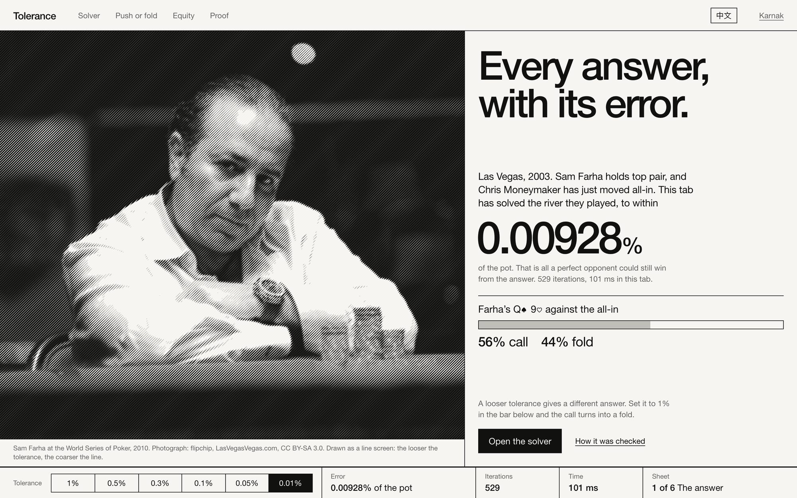

# Tolerance

A heads-up poker solver that runs in the browser and states its error.

**[tolerance-e09.pages.dev](https://tolerance-e09.pages.dev/)**



Every answer comes with its exploitability: what a perfect opponent could still win from the strategy shown. You set the tolerance; the solver runs until it is inside it.

## What it solves

- **Any river.** Two ranges, a board, a pot, stacks and bet sizes of your choosing, solved by Discounted CFR. The grid of 169 hands settles as the solve converges, and the convergence chart can be dragged to step back through every iteration.
- **A turn, with every river after it.** Give it four board cards and all 48 rivers are solved along with the turn. To keep that to a few seconds it uses one bet size and one raise on each street.
- **Push or fold before the flop.** The exact heads-up equilibrium at any stack from 1 to 25 big blinds, solved as you drag the ruler.
- **Equity.** One hand or range against another, on any board, by dealing every remaining board once. Nothing is sampled.

It does not solve the flop, and it does not handle more than two players.

## How it was verified

Each part is held against something outside it. `npm test` runs all of it; the Proof page of the site runs the same checks in your browser.

| Part | Checked against | Result |
| --- | --- | --- |
| Hand ranking | Published counts of each category among all 133,784,560 seven-card hands | Equal, all nine |
| Equity | Three independent counts: hand by hand, range by range, and over boards up to a relabelling of suits | Equal to the last board |
| River solver | Kuhn poker, value −1/18 (Kuhn, 1950), given to the solver as a river spot | −0.0555556 |
| River solver | A polarised range against a bluff-catcher, closed form (Chen and Ankenman, 2006) | Bluff ratio, calling frequency and value match at three bet sizes |
| Turn solver | Leduc hold'em, value −0.0856, the smallest well-known game with a card dealt between two betting rounds | −0.085606 |
| River and turn | The same two spots solved by [postflop-solver](https://github.com/b-inary/postflop-solver), an independent solver in Rust | Values equal to 0.0001 of the pot; every action frequency within one point |
| Exploitability | The same number computed a second way, comparing every pair of hands | Agree to 1e-9 |
| Push or fold | The [HoldemResources.net chart](https://www.holdemresources.net/hune), 338 numbers | 334 of 335 limits within 0.1 bb; the three split hands match at all nine boundaries |

The one push-or-fold number further off is Q4o: published as 7.9 bb, solved as always pushed up to 7.9 bb and then mixed, as an exactly indifferent hand, up to 8.3 bb. Every stack size is solved until less than 0.0000001 bb a hand is left to exploit.

## Speed

Apple M1, one thread, `npm run report`:

| River spot | Hands | After 500 iterations | After 1,000 |
| --- | --- | --- | --- |
| 2003 hand, 33 nodes | 222 v 236 | 0.010% of the pot, 0.11 s | 0.003%, 0.21 s |
| Dry river, 100 bb deep, 219 nodes | 427 v 525 | 0.11%, 1.4 s | 0.036%, 2.8 s |
| The same tree, every hand for both players | 1,081 v 1,081 | 0.11%, 3.3 s | 0.036%, 6.5 s |

The turn spot on the site (449 v 552 hands, 3,039 nodes) reaches 0.3% of the pot in about 4 seconds of solving. Push or fold: 34 ms a stack size on average. The preflop equity table takes two minutes to rebuild (`npm run table`).

## Run it

Node 24 or later.

```
npm install
npm run dev      # the site, on localhost
npm test         # the checks
npm run report   # the numbers above, on your machine
npm run build    # a static site in dist/
```

The engine is plain TypeScript with no dependencies: `src/engine`. The site adds none either.

## The first screen

The site opens on the best-known hand of the 2003 World Series of Poker Main Event, played heads-up for the title: Chris Moneymaker moves all-in on the river with king high and Sam Farha folds top pair. The cards, bets and stacks are as reported by [PokerNews](https://www.pokernews.com/strategy/analyzing-moneymaker-bluff-of-the-century-against-farha-35218.htm). The two ranges are an assumption, written out in `src/spots.ts`; change them on the page and it solves again.

Made by [Karnak](https://karnak.design).
